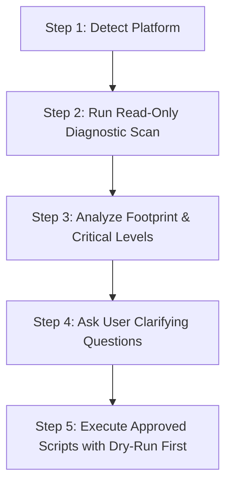

# Disk Cleanup Agent Skill & Operational Guide

This document instructs an LLM / AI agent on how to interact with this repository and clean a user's machine safely and effectively.

> **CRITICAL DIRECTIVE FOR THE LLM:**  
> **Never execute destructive cleanup scripts blindly.** A user pointing an LLM at this repository and saying "clean my computer" requires proactive risk assessment, diagnostic auditing, targeted user questions, and explicit confirmation before running any destructive script.

---

## 1. Operating Protocol: The 5-Step Workflow

When asked to clean the computer, always follow this phased workflow:



1. **Detect Platform:** Identify whether the host is Linux, macOS, or Windows (see [Platform Routing](#platform-routing)).
2. **Diagnostic Scan (100% Safe):** Run `scan_disk.sh` to quantify reclaimable storage without modifying or deleting any files.
3. **Classify by Critical Level:** Group potential targets by their recovery friction score (1 to 5).
4. **Ask Targeted Questions:** Formulate concise, specific questions based on the scan findings before proceeding.
5. **Execute Safely:** Run with dry-run flags (`-n` / `--dry-run`) first where applicable, confirm with the user, and report reclaimed space.

---

## 2. Criticality & Recovery Levels

Every cleanup target in this repository is categorized by recovery friction (how hard or disruptive it is to restore deleted files):

| Level | Rating | Impact & Recovery Effort | Reclaimable Targets | Recommended LLM Stance |
|:---:|---|---|---|---|
| **Level 1** | **Trivial / Zero Risk** | Restores automatically on next build, run, or browsing session. Takes seconds with zero mental effort. | Go build cache, browser HTTP cache, VS Code C++ IPCH, `__pycache__`, dangling Docker build cache (`<none>`). | **Safe to recommend eagerly.** Confirm once bundled with general cache approval. |
| **Level 2** | **Minor Friction** | Rebuildable via standard package managers (`npm install`, `pip install`, `cargo build`). Takes 1–10 minutes and internet bandwidth. | `node_modules`, Python `.venv`, Rust `target/`, `.gradle`, APT/Homebrew package download archives. | **Requires explicit project scope confirmation.** Warn user about reinstall time and bandwidth. |
| **Level 3** | **Moderate Friction** | Potential permanent data loss or heavy bandwidth consumption. Cannot be recovered without local backups or remote re-pulling. | Stopped Docker containers, unattached Docker volumes, unused Docker images. | **Requires mandatory explicit questions.** Specifically warn about database volumes and stopped containers. |
| **Level 4** | **High Friction** | Manual troubleshooting required; hours of disruption. | Active virtual environments lacking `requirements.txt`, uncommitted local code changes. | **Excluded by scripts.** Never delete. |
| **Level 5** | **Catastrophic** | System unbootable or repo corrupted; days of recovery. | `.git/` history, SSH keys (`~/.ssh`), system binaries (`/bin`, `/lib`), swap, active kernels. | **Strictly protected.** Scripts explicitly safeguard these; never override. |

---

## 3. Platform Routing

Determine the operating system and use the appropriate directory:

| Platform | Script Directory | Environment / Interpreter |
|---|---|---|
| **Linux** | Root directory (`./`) | `bash` |
| **macOS** | `mac/` (`./mac/`) | `bash` (macOS-specific paths, Xcode, Homebrew) |
| **Windows** | `windows/` (`.\windows\`) | `powershell` / `pwsh` |

---

## 4. Phase 1: Non-Destructive Diagnostics

Before asking questions or running deletions, run the read-only scanner to inspect disk consumption:

```bash
# Linux / macOS (Zero deletions, safe to execute immediately)
./scan_disk.sh

# Deep inspection for project node_modules and custom large file threshold:
./scan_disk.sh -d -t 50M
```

*For Windows, review the equivalent read-only checks in `windows\cleanup_no_docker.ps1 -DryRun`.*

---

## 5. Phase 2: Mandatory Clarifying Questions

Based on the scan findings, **ask the user targeted questions** before selecting and executing scripts. Group questions logically:

### A. Docker & Container Cleanup (Level 1 & Level 3)
* **Stopped Containers:**  
  *"Do you want to delete stopped Docker containers? (Any unsaved state inside exited containers will be lost.)"*
* **Unused Images:**  
  *"Do you want to remove unused Docker images, or only dangling `<none>` images? (Removing all unused images will require re-downloading them the next time you run those services.)"*
* **Docker Volumes (Highest Risk):**  
  *"Do you want to delete unattached Docker volumes? (Warning: If you ran a local database container whose data was stored in an anonymous or unattached volume, this data cannot be recovered without a backup.)"*

### B. Project Dependencies & Build Artifacts (Level 2)
* **Build Artifacts & Node Modules:**  
  *"We found project build artifacts (`node_modules`, `target/`, `.venv`) in your workspaces. Would you like to clean them? (You will need to run `npm install` or `pip install` before running these projects again.)"*
* **Target Directories:**  
  *"Should the scan target all detected project folders (e.g. `~/coding`, `~/projects`), or only a specific project directory?"*

### C. Developer Toolchain & Browser Caches (Level 1)
* **User-Space Caches:**  
  *"Can we safely clear package manager caches (Pip, Bun, NPM, Yarn, Go build cache, Cargo checkouts) and browser HTTP caches? (These are safe and rebuild automatically as needed.)"*

### D. System-Level Cleanup & Privileges (Level 2)
* **System Journals & Package Archives:**  
  *"Would you like to reclaim system storage (vacuum systemd journal logs to 200MB, clear APT/Homebrew cached archives, and prune disabled Snap revisions)? This requires `sudo` privileges."*

---

## 6. Phase 3: Decision Logic for Selecting Scripts

Use the answers to the questions above to determine the exact script and command-line arguments to run:

### Decision Matrix

| User Response / Requirement | Selected Script & Flags (Linux) | macOS Equivalent | Windows Equivalent |
|---|---|---|---|
| **Clean safe developer caches only (No Docker, No Project code)** | `./cleanup_no_docker.sh` | `./mac/cleanup_no_docker.sh` | `.\windows\cleanup_no_docker.ps1` |
| **Clean developer caches + system storage (with sudo)** | `sudo ./cleanup_no_docker.sh -s` | `sudo ./mac/cleanup_no_docker.sh -s` | `.\windows\cleanup_no_docker.ps1 -System` |
| **Clean project artifacts (`node_modules`, `.venv`, `target`)** | `./cleanup_artifacts.sh` *(preview with `-n` first)* | `./mac/cleanup_artifacts.sh` | `.\windows\cleanup_artifacts.ps1` |
| **Clean Docker safely (stopped containers, dangling images, build cache)** | `./cleanup_docker.sh` | `./mac/cleanup_docker.sh` | `.\windows\cleanup_docker.ps1` |
| **Clean Docker including unattached volumes (Explicitly Approved)** | `./cleanup_docker.sh -v` | `./mac/cleanup_docker.sh -v` | `.\windows\cleanup_docker.ps1 -Volumes` |
| **Full Docker purge (all unused images + volumes)** | `./cleanup_docker_unused.sh` | `./mac/cleanup_docker_unused.sh` | `.\windows\cleanup_docker_unused.ps1` |
| **High-impact curated quick cleanup (Go, Brave, Playwright, Snaps)** | `./cleanup_suggested.sh` *(preview with `-n`)* | *N/A (Linux specific)* | *N/A* |
| **System-only cleanup (journals, APT, Snaps)** | `sudo ./cleanup_system.sh` | `sudo ./mac/cleanup_system.sh` | `.\windows\cleanup_system.ps1` *(Admin)* |
| **Legacy user-space caches only** | `./cleanup_user.sh` | `./mac/cleanup_user.sh` | `.\windows\cleanup_user.ps1` |

---

## 7. Execution Safety Rules for the LLM

1. **Always preview when possible:** When using `cleanup_artifacts.sh`, `cleanup_suggested.sh`, or `cleanup_docker.sh`, run with `-n` or `--dry-run` first to show the user the estimated savings and paths.
2. **Never force deletion without consent:** Do not pass `-f` or `--force` unless the user explicitly requested non-interactive or unattended cleanup.
3. **Respect protected paths:** The scripts automatically protect `.git`, `.vscode`, `~/.ssh`, active virtual environments without project manifests, and current kernel images. **Never bypass these checks with raw `rm -rf` commands.**
4. **Report before & after:** Check disk space (`df -h /` or `df -h "$HOME"`) before and after running cleanup scripts to present a clear summary of reclaimed space to the user.
